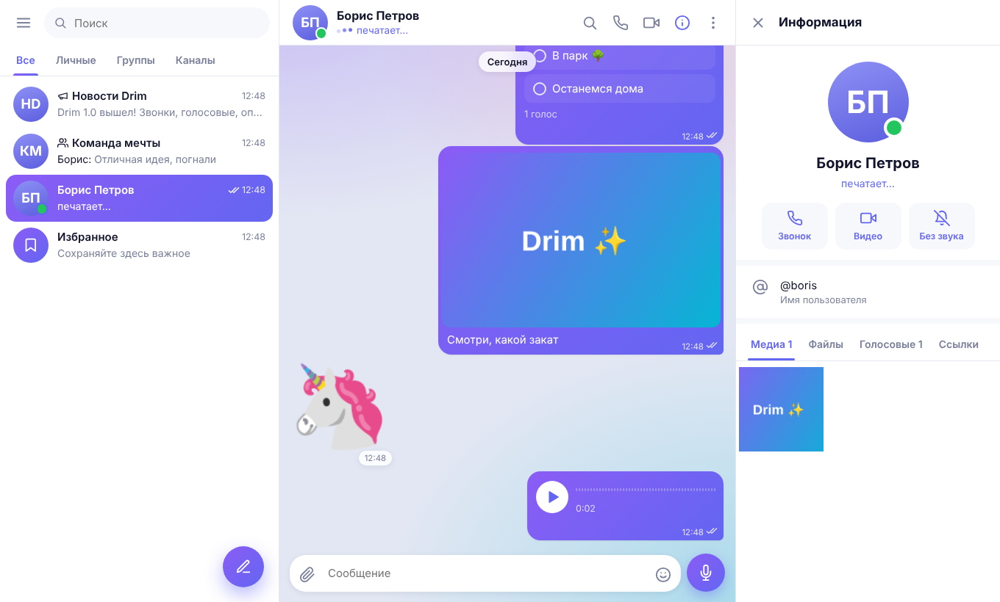
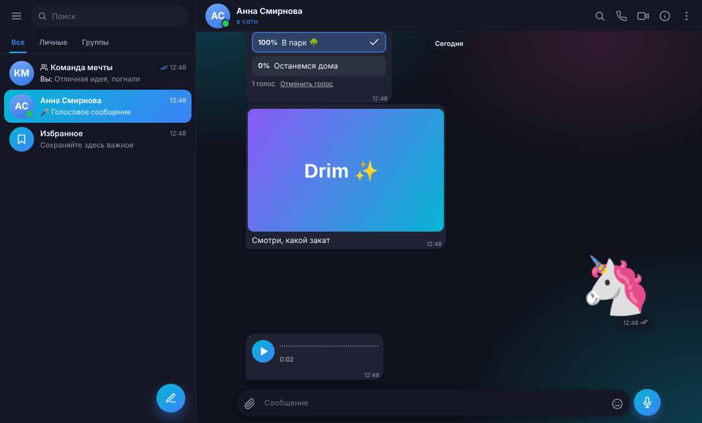
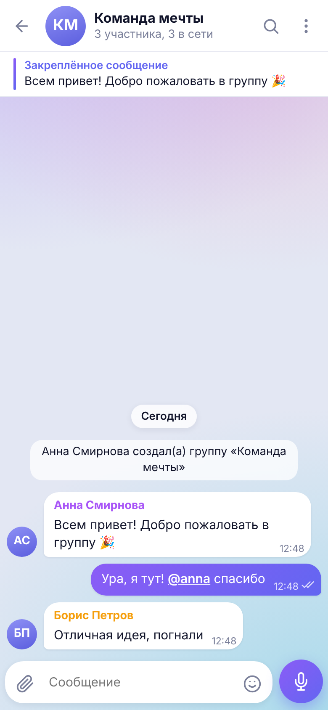
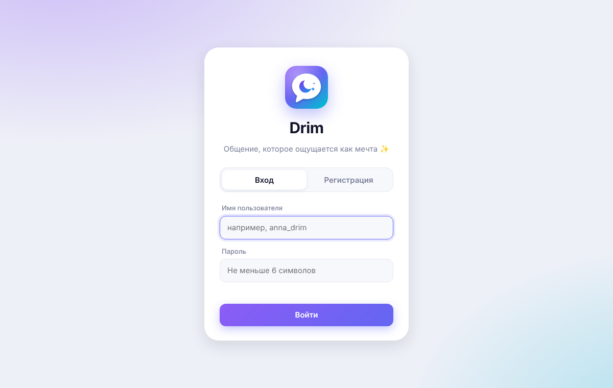

<p align="center"></p>

<h1 align="center">Drim</h1>
<p align="center">Быстрый и красивый мессенджер в реальном времени — «общение, которое ощущается как мечта» ✨</p>



## Возможности

**Общение**
- Личные чаты, группы, каналы и «Избранное» (чат с самим собой)
- Мгновенная доставка через WebSocket, статусы «отправлено / прочитано» (✓ / ✓✓)
- Индикаторы «печатает…», «записывает голосовое…», «отправляет файл…»
- Статус «в сети» и «был(а) N минут назад»
- Ответы на сообщения, пересылка (одного или нескольких), редактирование, удаление у всех
- Реакции эмодзи, закреплённые сообщения, выбор нескольких сообщений
- Форматирование: `**жирный**`, `__курсив__`, `~~зачёркнутый~~`, `` `код` ``, блоки кода, `||спойлер||`, цитаты `> `, ссылки и @упоминания
- Крупные эмодзи, анимированные стикеры, панель эмодзи с недавними

**Медиа**
- Фото и видео с предпросмотром и полноэкранным просмотрщиком (листание стрелками)
- Файлы до 100 МБ, перетаскивание (drag & drop) и вставка из буфера обмена
- Голосовые сообщения с волной громкости и перемоткой
- Опросы (анонимные/открытые, с одним или несколькими ответами)
- Отправка геопозиции

**Звонки**
- Аудио- и видеозвонки один на один (WebRTC): вызов, рингтон, принятие/отклонение, отключение микрофона и камеры, запись о звонке в чате

**Группы и каналы**
- Создатель, администраторы, добавление/удаление участников, назначение админов
- Название, описание, аватар, публичный доступ (поиск) и пригласительная ссылка
- В каналах публикуют только администраторы, остальные — подписчики

**Удобство**
- Папки: Все, Непрочитанные, Личные, Группы, Каналы, Архив
- Закрепление, архивирование, отключение звука чатов, очистка истории
- Глобальный поиск людей, публичных чатов и сообщений; поиск внутри чата
- Черновики для каждого чата, ↑ — редактировать последнее сообщение, Esc — отмена
- Профиль: аватар, имя, @username, «о себе», смена пароля
- Светлая/тёмная/автоматическая тема, 6 акцентных цветов, 6 обоев, размер шрифта
- Звуки и системные уведомления, счётчик непрочитанных в заголовке вкладки
- Адаптивный интерфейс для телефона, установка как приложения (PWA)

| Тёмная тема | Телефон | Вход |
|---|---|---|
|  |  |  |

## Запуск

Нужен Node.js 18+.

```bash
npm install
npm start
```

Откройте http://localhost:3000, зарегистрируйте пару аккаунтов (например, в обычном и приватном окне) и начните переписку.

Переменные окружения:

| Переменная | По умолчанию | Назначение |
|---|---|---|
| `PORT` | `3000` | Порт сервера |
| `DRIM_DATA` | `./data` | Папка для базы (`db.json`) и загруженных файлов |

> Для звонков, микрофона и уведомлений браузеры требуют HTTPS (или `localhost`). Для работы в интернете разместите Drim за обратным прокси с TLS (nginx, Caddy и т.п.).

## Иконка


Облачко сообщения с полумесяцем и искрами на градиенте «фиолетовый → индиго → бирюзовый». Название Drim созвучно слову *dream* — «мечта», поэтому в иконке ночное небо и звёзды: мессенджер для разговоров, которые хочется продолжать. Скруглённый квадрат подходит под стиль иконок iOS и Android.

Исходник — `public/icons/icon.svg`. PNG-версии (192, 512, maskable, apple-touch, favicon) пересоздаются командой `node scripts/gen-icons.js` (нужен Playwright).

## Устройство

```
server/
  index.js   HTTP + WebSocket сервер, вся логика чатов
  db.js      файловое хранилище (data/db.json)
public/
  index.html, styles.css, sw.js, manifest.webmanifest
  emoji.js   наборы эмодзи, стикеров и реакций
  js/core.js     утилиты, настройки, API, состояние
  js/layout.js   вход, каркас, список чатов, поиск, меню
  js/chat.js     окно чата, сообщения, ввод, голосовые, вложения
  js/modals.js   диалоги, панель информации, просмотр медиа
  js/calls.js    звонки WebRTC
  js/main.js     запуск и обработка событий сервера
```

Пароли хранятся как хэши scrypt, загруженные файлы раздаются с `Content-Security-Policy: sandbox` и `nosniff`.
